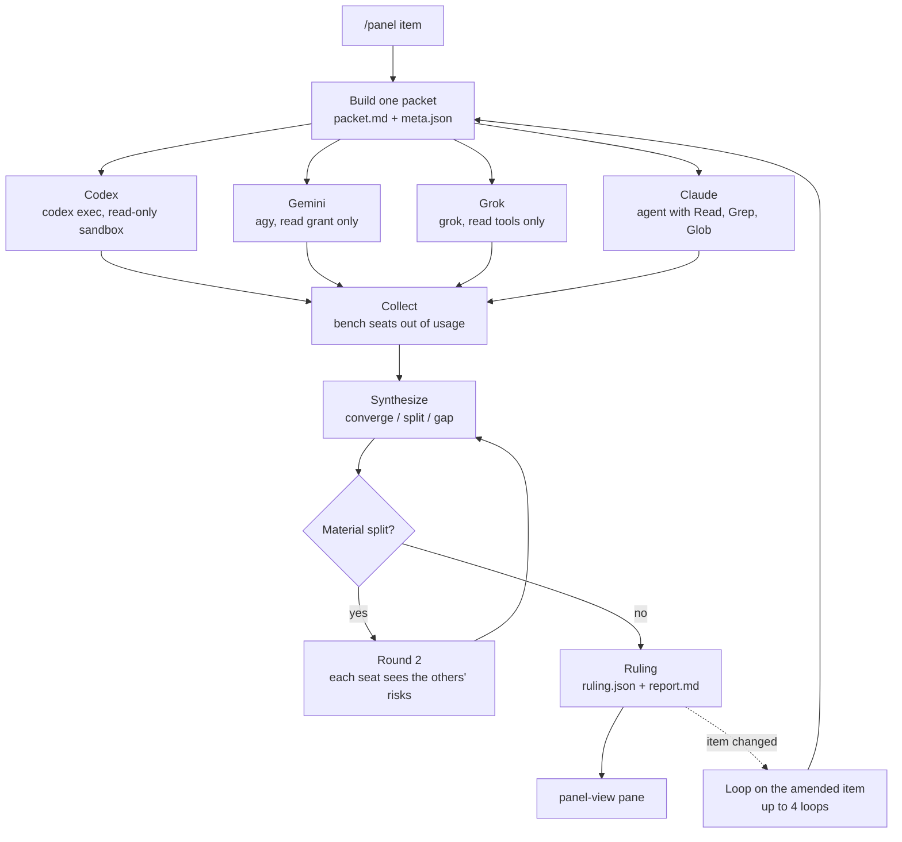
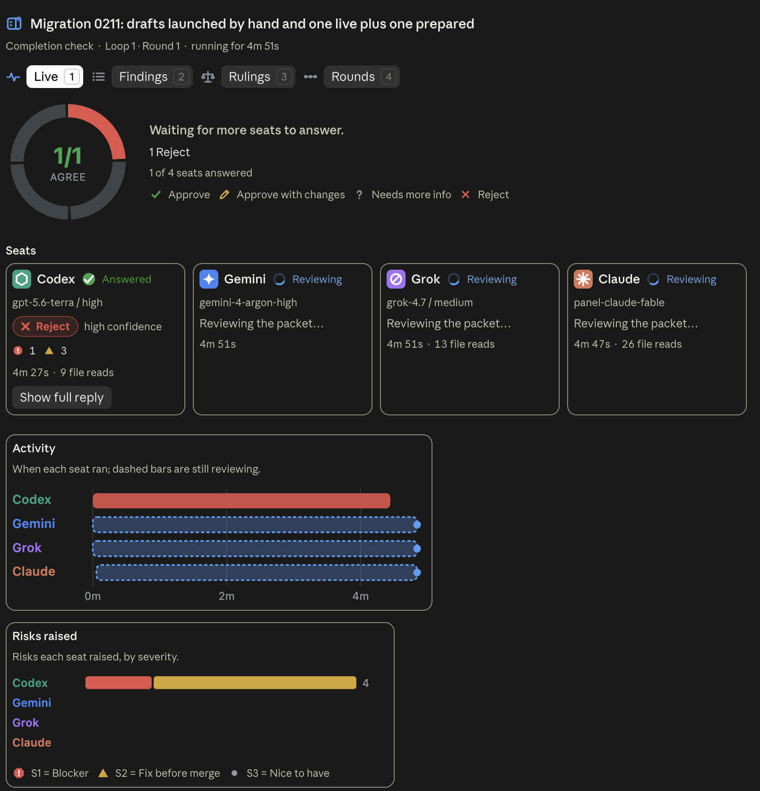
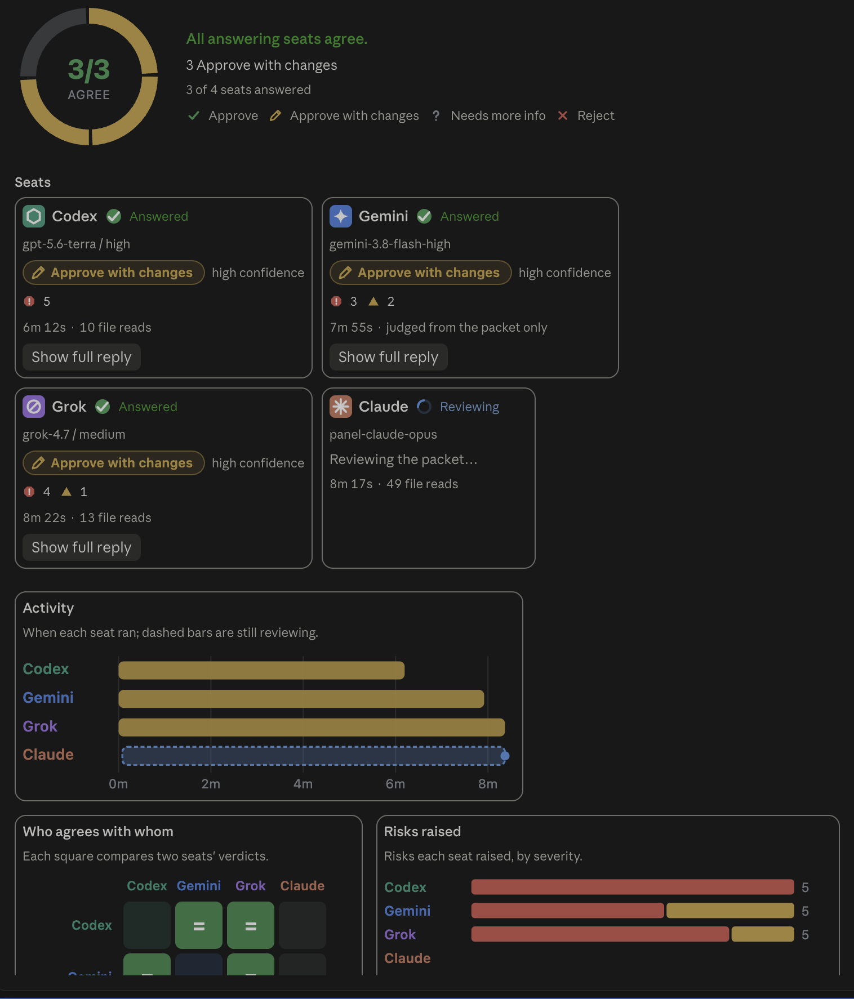

# multi-model-panel

**Ask four model families the same question, independently, before you ship.**

`/panel` takes a decision, a plan, a diff or a finished piece of work. It hands the same context packet to four read-only reviewers from four different labs: OpenAI Codex, Google Gemini, xAI Grok and a fresh Claude. Each one answers on its own in a fixed format. The model that called the panel then sorts their points into agreement, disagreement and single-seat catches. It checks the claims against the source and rules, crediting each point to the seat that raised it.

The point is blind-spot coverage. Models from one family tend to miss the same things. Models from four families mostly miss different things, and their disagreements are where the interesting risks hide.

This repo packages the whole workflow: the Claude Code skill, its agents and command, a live pane that draws each run, a native Codex version of the skill, and the companion Codex review skills.



## Contents

- [The seats](#the-seats)
- [What is in this repo](#what-is-in-this-repo)
- [Requirements](#requirements)
- [Install](#install)
- [Adapt it to your machine](#adapt-it-to-your-machine)
- [Using the panel](#using-the-panel)
- [The panel-view pane](#the-panel-view-pane)
- [The Codex-native version](#the-codex-native-version)
- [Companion skills](#companion-skills)
- [Keeping this repo in sync](#keeping-this-repo-in-sync)
- [License](#license)

## The seats

| Seat | Runs through | Model comes from | How it is kept read-only |
|---|---|---|---|
| **Codex** (OpenAI) | `codex exec` | `model` in `~/.codex/config.toml`; effort from `roster.json`, passed per run | `-s read-only`, plus plugins, apps, memories and every MCP server switched off. The seat is skipped if the lockdown can't be confirmed. |
| **Gemini** (Google) | `agy`, the Antigravity CLI | `roster.json` | The packet allows reads only. agy has `read_file` grants and no shell grant. |
| **Grok** (xAI) | `grok` CLI | `roster.json` | `--tools read_file,grep,list_dir`, `--disallowed-tools search_tool,use_tool,Agent` and `--deny MCPTool`. All three are needed. |
| **Claude** (Anthropic) | A Claude Code subagent | The agent file's frontmatter | The agent has only `Read`, `Grep` and `Glob`. |

The Claude seat always runs on a different model from the convener. On Fable the convener calls `panel-claude-opus`; on anything else it calls `panel-claude-fable`.

A seat whose provider reports it is out of usage is **benched** for the rest of the session. It is not retried or dispatched again, and the panel runs on the remaining seats. If no seat outside the Anthropic family is left, the panel refuses to convene rather than pass off a Claude-only answer as a panel ruling.

## What is in this repo

```
claude/                          mirrors ~/.claude
  skills/multi-model-panel/      the panel protocol (SKILL.md), roster.json, packet template
  agents/panel-claude-*.md       the two Claude seat agents
  commands/panel.md              the /panel alias
  mods/panel-view/               the live pane (a Claude Code plugin)
  skills/antigravity-cli/        single-Gemini offload through agy
  skills/claudex-loop/           recon, interview, adversarial Codex review, optional build
  skills/codex-review/           one Codex critic iterates a PLAN.md to APPROVED
  skills/codex-build/            Codex implements a frozen plan (unsandboxed)
codex/                           mirrors ~/.codex
  skills/multi-model-panel/      the native Codex version, with a Python seat runner and tests
docs/
  CLAUDE-md-snippet.md           routing rules to paste into ~/.claude/CLAUDE.md
  run-dir-contract.md            the files each run writes, and what the pane reads
scripts/
  install.sh                     copy everything into place and register the pane
  doctor.sh                      check the seat CLIs and the roster
  sync-from-local.sh             refresh this repo from the live ~/.claude and ~/.codex
.claude-plugin/marketplace.json  makes this repo a plugin marketplace for panel-view
```

## Requirements

- **Claude Code** with plugin support (the CLI or the desktop app). The pane needs a version with mods. The skill works without it.
- **At least one non-Anthropic seat CLI**, signed in. All three is the intended setup:
  - [Codex CLI](https://github.com/openai/codex) (`codex`), signed in with a ChatGPT account. Developed against codex-cli 0.159.1 and later.
  - Antigravity CLI (`agy`) at `~/.local/bin/agy`, signed in with Google.
  - Grok CLI (`grok`) at `~/.grok/bin/grok`, signed in.
- **`jq`**, **`perl`** and **`git`**. `perl` gives the time limit, because stock macOS has no `timeout` command.
- **Python 3**, only for the Codex-native version.
- **macOS** is the tested platform. The pane falls back to `stat -f` when it can't read a file directly, which is BSD syntax.

## Install

```bash
git clone https://github.com/Qslick/multi-model-panel.git ~/Development/multi-model-panel
```

```bash
~/Development/multi-model-panel/scripts/install.sh
```

The installer does four things:

1. **Copies the skills, agents and `/panel` command** into `~/.claude`. An existing copy that differs is moved aside to `<name>.bak-<timestamp>` first. Running it twice is safe.
2. **Copies the Codex-native skill** into `~/.codex/skills/multi-model-panel`.
3. **Installs the pane** with `claude plugin install panel-view --marketplace <this repo>`. Keep the clone where it is, because Claude Code reads the plugin from it. If a `panel-view` plugin is already installed from another marketplace, the installer leaves it alone.
4. **Prints the remaining steps.**

Options:

| Flag | Effect |
|---|---|
| `--dry-run` | Show what would happen and change nothing |
| `--panel-only` | Skip the companion skills |
| `--no-codex` | Skip the Codex-native skill |
| `--no-mod` | Skip the pane |
| `--claude-home DIR`, `--codex-home DIR` | Install somewhere other than `~/.claude` and `~/.codex` |

Then finish by hand:

1. **Paste the routing rules** from [`docs/CLAUDE-md-snippet.md`](docs/CLAUDE-md-snippet.md) into `~/.claude/CLAUDE.md`. They tell Claude to offer the panel before and after risky work.
2. **Reload.** Run `/reload-plugins` in any session that was already open.
3. **Check the machine.**

```bash
~/Development/multi-model-panel/scripts/doctor.sh
```

The doctor confirms each CLI and both agents are present. It also checks that the roster's Gemini and Grok model ids still appear in `agy models` and `grok models`. Pass `--offline` to skip those two provider calls.

### Installing only the pane

The repo is a plugin marketplace, so the pane installs straight from GitHub without cloning:

```bash
claude plugin install panel-view --marketplace Qslick/multi-model-panel
```

## Adapt it to your machine

The files are a snapshot of a working setup, so a few values are the author's. Check these before your first run.

- **`claude/skills/multi-model-panel/roster.json`** holds the Gemini and Grok model ids, the Codex and Grok efforts, and the Claude agent names. It is the only place to change them. The skill also bumps the Grok id itself when `grok models` lists a newer version.
- **`~/.codex/config.toml`** must name the Codex model. The skill reads it and never passes `-m`, because pinning a model id has returned HTTP 400 on ChatGPT-account sign-in.
- **The agent files** (`agents/panel-claude-fable.md` and `panel-claude-opus.md`) set the Claude seat's model and effort in their frontmatter.
- **The Gemini read grant** is in SKILL.md §0 step 9. Headless agy cannot ask for permission, so a read outside its workspace is silently denied and the seat returns nothing. The skill restores `read_file(...)` allow rules in `~/.gemini/antigravity-cli/settings.json` when they are missing. Those rules name the author's paths: `/private/tmp/claude-501`, `/tmp/claude-501` and `/Users/quinnbreedlove/Development`. Change them to your own temp directory and code folder.
- **CLI locations.** agy is expected at `~/.local/bin/agy` and grok at `~/.grok/bin/grok`. Edit SKILL.md §2 if yours live elsewhere.

Never add shell or write grants to agy, and never add `--yolo`, `--always-approve` or a sandbox bypass to any seat. The gotchas section at the end of SKILL.md records why each of those was tried and rejected.

## Using the panel

```text
/panel should we move session storage from Redis to Postgres?
/panel PLAN.md
/panel the diff on this branch against main
/panel completion check
```

The skill picks one of three modes for the packet:

| Mode | The question | What APPROVE means |
|---|---|---|
| `decide` | A choice between options | The proposed choice is sound |
| `plan` | A plan before work starts | The plan can be built as written |
| `completion` | Work you just finished | It is done and does what it claims |

A run goes like this:

1. **Packet.** The convener writes `packet.md`, with the material inlined so every seat reads the same bytes. When the item is code, it pins the exact commit, using a clean detached checkout if the working tree has moved.
2. **Dispatch.** All available seats start in one message: one Bash call for the three CLI seats, in parallel, plus one Agent call for Claude. Each is bounded to about nine and a half minutes.
3. **Collect.** An empty or malformed reply is retried once. A permission denial is reported at once, not retried. An out-of-usage error benches the seat for the session. The convener also checks whether each seat actually read the files, and labels a seat that answered from the packet alone as packet-only.
4. **Synthesize.** Every point lands in one bucket: converge (two or more seats), split (seats contradict) or gap (one seat). The convener verifies factual claims against the source before acting on them or overruling them.
5. **Round 2**, only on a material split. Each seat sees the others' top risks and disagreements, without model names, and revises or restates.
6. **Report.** The outcome and tally come first, then the splits, the ruling with every point credited to a seat, the overruled objections with reasons, and the gaps worth a look.

When the ruling changes the item, the panel has reviewed the old version. Ask it to **iterate** ("rerun the panel until it converges") and it re-reviews the amended item, up to four loops. Each loop checks that every change fixed its target without breaking something new.

Every run keeps its files in its own directory. [`docs/run-dir-contract.md`](docs/run-dir-contract.md) lists them.

## The panel-view pane

`panel-view` is a Claude Code plugin that watches panel runs and draws them live in a docked pane. Open it with `/panel-view`.

- **Live** shows each seat's status, model and elapsed time, plus a verdict donut and an agreement matrix as replies land.
- **Findings** lists every risk, filterable by seat and severity.
- **Rulings** draws `ruling.json`: each point's bucket, severity and the convener's ruling, with the reasons.
- **Rounds** compares round 1, round 2 and every loop of the same decision side by side.



*Live, mid-run. Codex has answered; Gemini, Grok and Claude are still reviewing, shown as dashed bars on the activity timeline.*



*Live, later in a run. Three seats agree, the agreement matrix and risk bars fill in, and Claude is still reading files.*

When a seat fails because its CLI needs signing in again, the pane offers a sign-in button, and then a Retry button that asks the convener to rerun only that seat.

The pane finds runs by watching for the skill's dispatch command and reading the run directory. If you rename files or change the dispatch command in SKILL.md, update the mod too. The [run-dir contract](docs/run-dir-contract.md) lists what it depends on.

## The Codex-native version

`codex/skills/multi-model-panel` is the same panel for when **Codex is the convener**. Invoke it from Codex as `$multi-model-panel`. It shares the packet template and reply format, with these differences:

- **The Codex seat is the opposite model.** `scripts/panel.py resolve` reads the convening model from the current Codex session log. The seat then runs the other model, mapped in `roster.json` (Sol reviews Astra's work and the reverse), with an explicit `--model`.
- **The Claude seat** runs through `claude --print --safe-mode` with only `Read`, `Grep` and `Glob`, not a subagent.
- **Each seat runs through the helper**, `panel.py seat <codex|gemini|grok|claude>`. It enforces the time limit and writes a `SEAT.json` receipt with the packet hash, the exact command, the exit code and the extracted reply.
- **The bench file** is `${TMPDIR}/panel-bench-codex-<session>.txt`, separate from the Claude side.
- **No `meta.json` or `ruling.json`**, so the pane does not show Codex-convened runs.

Run its tests from the scripts folder:

```bash
cd ~/.codex/skills/multi-model-panel/scripts && python3 test_panel.py
```

Known gaps in this snapshot:

- Its roster still lists `gemini-3.8-flash-high`, older than the Claude side's Gemini model.
- It maps only `gpt-6-sol` and `gpt-6-astra`. With another convening model, pass `--convener-model` with one of those two.

## Companion skills

These sit beside the panel and route to it.

| Skill | Use it when |
|---|---|
| `/codex-review` | You want one Codex critic to iterate a `PLAN.md` until it says APPROVED, in the same Codex session |
| `/claudex-loop` | Requirements still need an interview: recon, interview, adversarial Codex review, then an optional build |
| `/codex-build` | You want Codex to implement a frozen plan. **This one runs Codex with full write access and no approval prompts.** Claude reads the whole diff and runs the checks before anything is committed. Invoke it only on purpose; it is never offered proactively. |
| `antigravity-cli` | You want a single Gemini opinion or a bulk read-only sweep through agy |

`claudex-loop`, `codex-review` and `codex-build` started from [chaseai-yt/claudex-loop](https://github.com/chaseai-yt/claudex-loop) under the MIT License and have been adapted since. See [THIRD_PARTY_NOTICES.md](THIRD_PARTY_NOTICES.md).

## Keeping this repo in sync

The live copies in `~/.claude` and `~/.codex` are the working copies. This repo is a snapshot of them. After editing a live copy:

```bash
~/Development/multi-model-panel/scripts/sync-from-local.sh
```

It copies every tracked path back into the repo, deletes files the live copy dropped, and shows the diff. It never commits. Review it, then commit and push as usual. `scripts/paths.sh` lists what is tracked, for both the sync and the installer.

## License

MIT. See [LICENSE](LICENSE). The claudex-loop family keeps its original MIT notice in [THIRD_PARTY_NOTICES.md](THIRD_PARTY_NOTICES.md).
